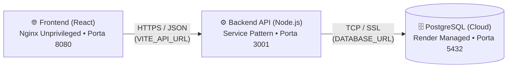

# 📚 LendoMais (BiblioTech) — Operação Nuvem Literária

> **Arquitetura de Deploy em Contêineres com Docker Multi-Stage, Docker Hub e Render**

Plataforma web de catálogo e gerenciamento de acervo literário desenvolvida com **React (Vite)** no frontend, **Node.js + Express (Service Pattern)** no backend e **PostgreSQL** como banco de dados relacional. Este repositório contém toda a engenharia de contêineres, práticas de segurança (**DevSecOps**) e documentação para publicação em nuvem.

---

## 🏗️ Arquitetura da Solução



### Pilares de Engenharia e DevSecOps Aplicados
* **Multi-Stage Builds (`Dockerfile`):** Separação estrita entre estágio de compilação (`builder`) e execução (`production`), eliminando ferramentas de build, caches e dependências de desenvolvimento da imagem final.
* **Princípio do Menor Privilégio (Non-Root):**
  * O contêiner do **Backend** executa sob um usuário dedicado sem privilégios (`appuser`).
  * O contêiner do **Frontend** utiliza a imagem oficial `nginxinc/nginx-unprivileged` escutando na porta `8080` sem necessidade de `root`.
* **Injeção Dinâmica de Variáveis no Frontend (`docker-entrypoint.sh`):** Como aplicações Vite/React são estáticas após o build, foi implementado um *entrypoint* que injeta a variável `VITE_API_URL` diretamente no momento em que o contêiner sobe no Render — permitindo usar a mesma imagem imutável do Docker Hub em qualquer ambiente.
* **Compatibilidade Nativa com Render PostgreSQL:** O backend suporta tanto a string única `DATABASE_URL` (com negociação SSL automática em produção) quanto variáveis individuais (`DB_HOST`, `DB_PORT`, `DB_USER`, `DB_PASSWORD`, `DB_NAME`).
* **Roteamento SPA e Hardening HTTP:** Configuração customizada do Nginx (`nginx.conf`) com `try_files $uri $uri/ /index.html` para evitar erros `404` nas rotas do React e cabeçalhos de proteção (`X-Frame-Options`, `X-Content-Type-Options`, `Referrer-Policy`).

---

## 📁 Estrutura do Repositório

```text
Desafio/
├── backend/
│   ├── src/
│   │   ├── config/database.js        # Pool PostgreSQL (suporte a DATABASE_URL + SSL)
│   │   ├── controllers/              # Camada de entrada HTTP
│   │   ├── repositories/             # Camada de persistência SQL
│   │   ├── routes/                   # Definição de rotas REST (/api/books)
│   │   ├── services/                 # Regras de negócio (Service Pattern)
│   │   ├── app.js                    # Express, CORS e endpoint /health
│   │   └── server.js                 # Inicialização do servidor e tabela books
│   ├── .dockerignore
│   ├── .env.example
│   ├── database.sql
│   ├── Dockerfile                    # Multi-stage build Node.js 20 Alpine (non-root)
│   └── package.json
├── frontend/
│   ├── src/
│   │   ├── services/bookService.js   # Cliente Axios integrado à VITE_API_URL
│   │   ├── App.css
│   │   ├── App.jsx
│   │   └── main.jsx
│   ├── .dockerignore
│   ├── .env.example
│   ├── docker-entrypoint.sh          # Injeção de VITE_API_URL em runtime
│   ├── Dockerfile                    # Multi-stage build Vite -> Nginx Unprivileged
│   ├── index.html
│   ├── nginx.conf                    # Configuração SPA + Security Headers
│   └── package.json
├── docker-compose.yml                # Orquestração completa para testes locais
└── README.md                         # Documentação técnica e entregáveis
```

---

## 🚀 Como Executar Localmente (Validação com Docker Compose)

Antes de enviar as imagens para o registro público, valide toda a stack localmente:

```bash
# 1. Subir PostgreSQL, Backend API e Frontend Nginx
docker compose up --build -d

# 2. Verificar status e healthchecks dos contêineres
docker compose ps
```

* **Frontend:** `http://localhost:8080`
* **Backend API:** `http://localhost:3001/api/books`
* **Healthcheck:** `http://localhost:3001/health`

Para encerrar o ambiente local:
```bash
docker compose down -v
```

---

## 📦 Build e Publicação no Docker Hub

Substitua `<seu-usuario>` pelo seu identificador no Docker Hub:

### 1. Autenticação no Docker Hub
```bash
docker login
```

### 2. Build e Push do Backend
```bash
cd backend
docker build -t <seu-usuario>/lendomais-backend:1.0.0 -t <seu-usuario>/lendomais-backend:latest .
docker push <seu-usuario>/lendomais-backend:1.0.0
docker push <seu-usuario>/lendomais-backend:latest
```

### 3. Build e Push do Frontend
```bash
cd ../frontend
docker build -t <seu-usuario>/lendomais-frontend:1.0.0 -t <seu-usuario>/lendomais-frontend:latest .
docker push <seu-usuario>/lendomais-frontend:1.0.0
docker push <seu-usuario>/lendomais-frontend:latest
```

---

## ☁️ Guia de Deploy no Render (Existing Image)

### Passo 1: Banco de Dados PostgreSQL
1. No painel do Render, clique em **New +** $\rightarrow$ **PostgreSQL**.
2. Escolha o plano **Free**, crie o banco e copie a **Internal Database URL** (ou *External Database URL*).

### Passo 2: Web Service — Backend API
1. Clique em **New +** $\rightarrow$ **Web Service** $\rightarrow$ **Deploy an existing image from a registry**.
2. Informe a imagem: `<seu-usuario>/lendomais-backend:latest`.
3. Em **Environment Variables**, adicione:
   * `NODE_ENV` = `production`
   * `PORT` = `3001`
   * `DATABASE_URL` = *(cole a URL do PostgreSQL criada no Passo 1)*
   * `CORS_ORIGIN` = `*` *(ou a URL do frontend após criá-lo)*
4. Finalize o deploy e copie a URL pública gerada (ex: `https://lendomais-api.onrender.com`).

### Passo 3: Web Service — Frontend (React + Nginx)
1. Clique em **New +** $\rightarrow$ **Web Service** $\rightarrow$ **Deploy an existing image from a registry**.
2. Informe a imagem: `<seu-usuario>/lendomais-frontend:latest`.
3. Em **Environment Variables**, adicione:
   * `VITE_API_URL` = `https://lendomais-api.onrender.com/api` *(substitua pela URL real do seu backend no Render)*
   * `PORT` = `8080`
4. Finalize o deploy e acesse a URL pública do Frontend.

---

## 📋 Entregáveis do Desafio (Preencher com seus links finais)

* **Repositório Docker Hub (Frontend):** `https://hub.docker.com/r/<seu-usuario>/lendomais-frontend`
* **Repositório Docker Hub (Backend):** `https://hub.docker.com/r/<seu-usuario>/lendomais-backend`
* **URL Pública do Frontend (Render):** `https://lendomais-frontend.onrender.com`
* **URL Base da API Backend (Render):** `https://lendomais-api.onrender.com/api`
* **Repositório GitHub:** `https://github.com/<seu-usuario>/<seu-repositorio>`

### Relato Técnico — Maior Desafio Enfrentado no Deploy em Nuvem
> O maior desafio técnico na transição do ambiente local para a nuvem do Render foi conciliar o **empacotamento imutável de uma aplicação SPA (React/Vite)** com a **injeção dinâmica de variáveis de ambiente (`VITE_API_URL`) e a conexão segura com o banco PostgreSQL gerenciado**. Como o Vite incorpora variáveis `VITE_*` durante a fase de build (`npm run build`), gerar a imagem Docker antes de conhecer a URL pública gerada pelo Render faria com que o frontend continuasse apontando para `localhost:3001`. Para resolver isso de forma profissional e alinhada às práticas de DevSecOps (12-Factor App), foi implementado um *entrypoint* customizado no contêiner Nginx (`docker-entrypoint.sh`) que injeta a URL real da API em *runtime*, aliado à configuração de SSL obrigatório na string `DATABASE_URL` do backend e à política de CORS entre os dois domínios HTTPS no Render.
